

# Since Us

**A privacy-friendly Android app for couples.** 
Counts how long you have been together and reminds you of every special day.

[Website](https://sinceus.de/) · [Download](#download) · [Help translate](#help-translate) · [Roadmap](ROADMAP.md) · [Contributing](CONTRIBUTING.md) · [Scope](SCOPE.md) · [Support](#support-the-project)

<a href="#download"><picture><source media="(prefers-color-scheme: dark)" srcset=".github/readme/btn-download-dark.png"></picture></a>&nbsp;&nbsp;<a href="#support-the-project"><picture><source media="(prefers-color-scheme: dark)" srcset=".github/readme/btn-support-dark.png">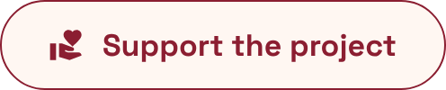</picture></a>

  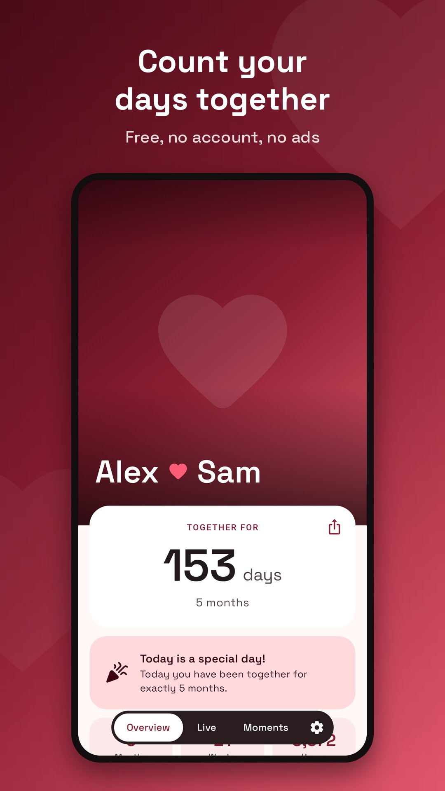
  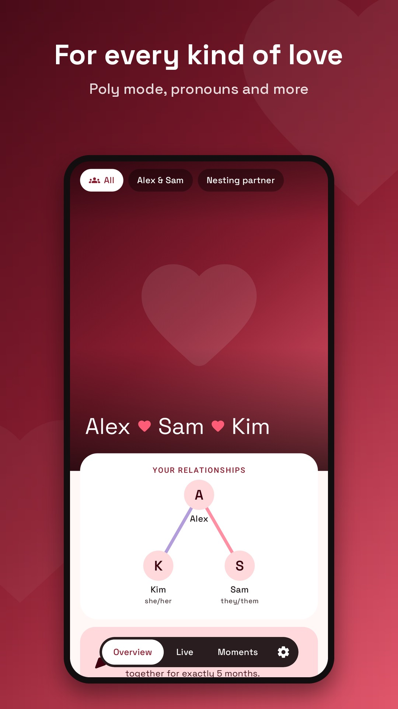
  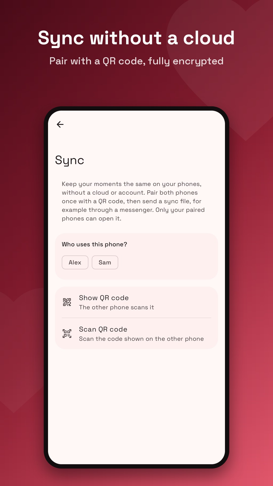

## Why Since Us

<picture><source media="(prefers-color-scheme: dark)" srcset=".github/readme/why-dark.png">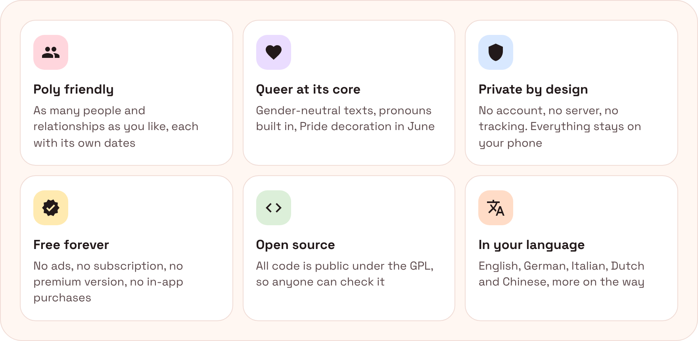</picture>

## Support the project

<a href="https://opencollective.com/sinceus">
  <picture>
    <source media="(prefers-color-scheme: dark)" srcset=".github/readme/support-dark.png">
    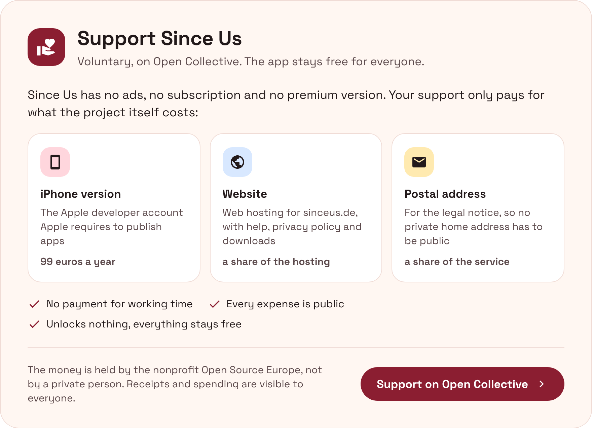
  </picture>
</a>

Since Us is and stays free, with no ads, no subscription and no premium version. Supporting it on **[Open Collective](https://opencollective.com/sinceus)** is completely voluntary. The money is held by the nonprofit Open Source Europe and only pays for what the project itself costs:

| What | Why | Cost |
| --- | --- | --- |
| Apple developer account | Needed to publish the iPhone version ([#53](https://github.com/DerDieDasLian/sinceus/issues/53)) | 99 euros a year |
| Web hosting | Keeps [sinceus.de](https://sinceus.de/) online with help, privacy policy and downloads | a share of the hosting |
| Postal address | For the legal notice, so no private home address has to be public | a share of the service |

Working time is not paid from it, and every expense is public on [Open Collective](https://opencollective.com/sinceus).

## Features

<picture><source media="(prefers-color-scheme: dark)" srcset=".github/readme/features-dark.png">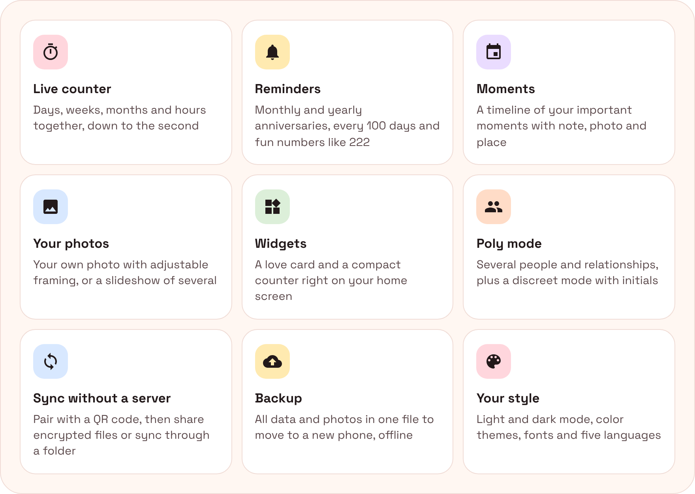</picture>

<b>All features in detail</b>

- Days, weeks, months and hours together, plus a live counter down to the second
- Your own photo with adjustable framing, or one of several backgrounds, plus an optional slideshow with more photos
- Notifications on monthly and yearly anniversaries, every 100 days, fun numbers like 222 and every 50 weeks, at a time you choose
- Upcoming special days with a countdown
- Moments: a timeline of important moments with note, photo and yearly reminder (can be hidden)
- Two home screen widgets: a love card with your names and days together, and a compact counter in Material You colors
- Guided setup, optional start time, one-tap "delete all data"
- Backup as a file (all data and photos) to move to a new phone, without internet
- Sync between phones without a server: pair once with a QR code, then send each other an encrypted file (AES-256-GCM) that opens right in the app and only on your paired phones. Or let it happen by itself through a folder that another app keeps in sync, also with several devices per person, while Since Us itself stays offline
- Light and dark mode, English, German, Italian, Dutch and Chinese (more on the way), language can be changed right in the app
- No account, no ads, no tracking, all data stays on the device
- Poly mode: more than two people and several relationships, each with its own date, special days and reminders, plus a discreet mode with initials only
- For every kind of love, no matter who you are, whom you love or how many of you there are, with a little rainbow decoration in Pride Month (June)

## Download

<a href="https://github.com/DerDieDasLian/sinceus/releases/latest"><picture><source media="(prefers-color-scheme: dark)" srcset=".github/readme/dl-github-dark.png">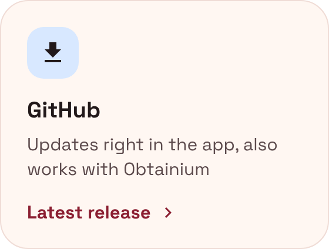</picture></a>
<a href="https://f-droid.org/packages/app.sinceus/"><picture><source media="(prefers-color-scheme: dark)" srcset=".github/readme/dl-fdroid-dark.png">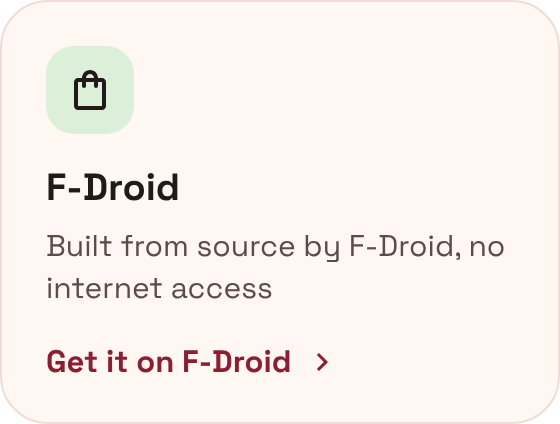</picture></a>
<a href="#help-test-on-google-play"><picture><source media="(prefers-color-scheme: dark)" srcset=".github/readme/dl-play-dark.png">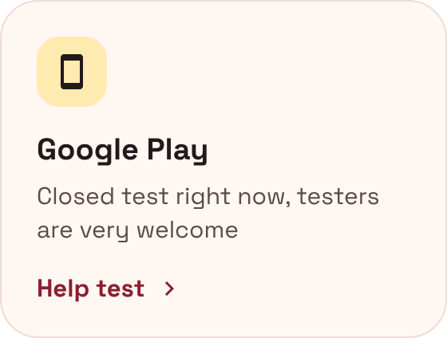</picture></a>

The GitHub version checks for a new release once a day, notifies you and installs it with one tap (can be turned off). It also works with [Obtainium](https://github.com/ImranR98/Obtainium). The three versions are signed differently, so switching between them requires uninstalling first.

Tip: if notifications arrive late, set *Settings → Apps → Since Us → Battery* to "Unrestricted".

## Get involved

<a href="#help-translate"><picture><source media="(prefers-color-scheme: dark)" srcset=".github/readme/in-translate-dark.png">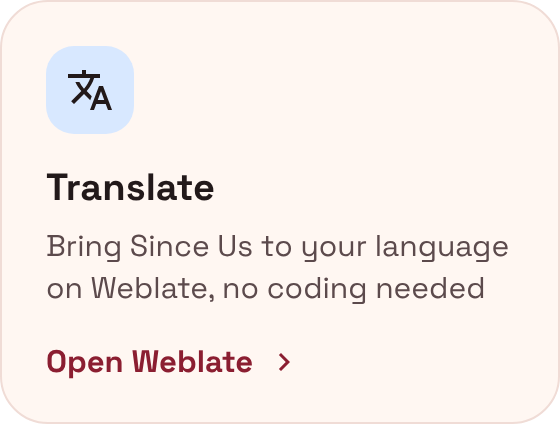</picture></a>
<a href="https://github.com/DerDieDasLian/sinceus/issues/new?template=feature_request.yml"><picture><source media="(prefers-color-scheme: dark)" srcset=".github/readme/in-idea-dark.png">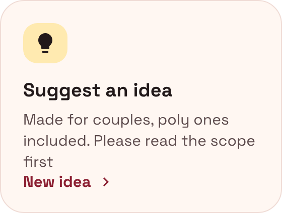</picture></a>
<a href="https://github.com/DerDieDasLian/sinceus/issues/new?template=bug_report.yml"><picture><source media="(prefers-color-scheme: dark)" srcset=".github/readme/in-bug-dark.png">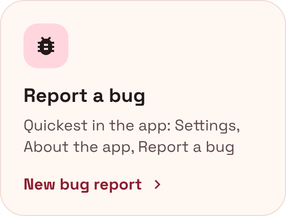</picture></a>

Bug reports, ideas, translations and small fixes are welcome. See [CONTRIBUTING.md](CONTRIBUTING.md) for how to help, and please follow the [Code of Conduct](CODE_OF_CONDUCT.md). Security problems should be reported privately, see the [security policy](.github/SECURITY.md).

### What Since Us is (and isn't)

Since Us is made for couples, poly ones included. Friendship and family can be chosen per relationship in the settings, but the app stays built around couples. It will never have ads, accounts, tracking or anything that costs money. The details are in [SCOPE.md](SCOPE.md), please read it before suggesting an idea. What is planned next is on the [roadmap](ROADMAP.md).

### Help translate

Since Us is translated on [Weblate](https://hosted.weblate.org/engage/since-us/), a free platform for open source translations. Everyone is welcome, no programming needed.

1. Sign in on [hosted.weblate.org](https://hosted.weblate.org/engage/since-us/) (for example with GitHub).
2. Pick your language. If it is not listed yet, you can add it there.
3. Translate as much or as little as you like. Weblate sends your work to this repository.

A few notes:

- A language is added to the app once it is (almost) complete, so nobody sees a half-translated app. Until then your work is safe in the repository.
- The store listing (title and descriptions for F-Droid) is part of it too. Old changelogs don't need to be translated.
- Please keep the tone warm and simple. Since Us is for every kind of love, so gender-neutral wording is great where your language allows it.
- Found a wrong or awkward text in the app? Fix it right on Weblate, or open an [issue](https://github.com/DerDieDasLian/sinceus/issues/new/choose).
- Something unclear in the English text? Leave a comment on Weblate or open an [issue](https://github.com/DerDieDasLian/sinceus/issues/new/choose).

### Help test on Google Play

Before Since Us can go live on Google Play, Google wants the app tested for 14 days by at least 12 people. Want to help? You need an Android phone and a Google account.

1. Write to [contact@sinceus.de](mailto:contact@sinceus.de?subject=Since%20Us%20Google%20Play%20test) with the Google address (Gmail) you use on your phone.
2. You get a link to join the test and install Since Us from Google Play.
3. Keep the app installed for 14 days and open it now and then. Feedback is welcome, but not required.

Your address is only used to add you to the test.

## For developers

<b>Build variants, releasing and libraries</b>

### Build variants

| Variant | Gradle task | Internet | Updates |
| --- | --- | --- | --- |
| `github` | `./gradlew assembleGithubRelease` | only for the update check | GitHub Releases |
| `fdroid` | `./gradlew assembleFdroidRelease` | none | F-Droid |
| `play` | `./gradlew bundlePlayRelease` | none | Google Play |

Tests, screenshots and store graphics: `./gradlew testGithubDebugUnitTest` (output in `app/build/screenshots` and `app/build/store`).

### Releasing

- **Signing:** create `keystore.properties` (not committed) with `storeFile`, `storePassword`, `keyAlias`, `keyPassword`. Without it, release builds stay unsigned (this is what F-Droid expects). In GitHub Actions the secrets `UPLOAD_KEYSTORE_BASE64`, `UPLOAD_KEYSTORE_PASSWORD`, `UPLOAD_KEY_ALIAS` and `UPLOAD_KEY_PASSWORD` are used.
- **Releases are made on purpose:** changes collect on the default branch until a release is started by hand (Actions > Release > Run workflow, type `auto`, `patch`, `minor` or `major`; `auto` honors `[minor]`/`[major]` in commit messages). The workflow bumps the version, checks that `fastlane/metadata/android/{de-DE,en-US}/changelogs/<versionCode>.txt` exist (at most 500 characters, shown in the app, on F-Droid and on GitHub), runs the tests, builds all variants, then commits the version, tags `v<versionName>` and publishes the signed APK. F-Droid builds every new tag. Every app change adds a line to the notes for the next versionCode; the Build workflow warns while they are missing. Pull before working, since the release workflow pushes version commits.
- **F-Droid** builds the `fdroid` variant from source; store texts and images are in `fastlane/`, a metadata template is in `fdroid/`.
- **Website:** `docs/` (landing page and privacy policy) is published via GitHub Pages and can be copied to any static web server.

### Tech

Kotlin, Jetpack Compose (Material 3), Glance widgets, DataStore, Coil. Minimum Android 8.0.

### Third-party libraries

Since Us uses Android Jetpack (AndroidX, Jetpack Compose, Material 3, Glance, DataStore), Kotlin and kotlinx.coroutines, Coil, Okio, Guava ListenableFuture, Accompanist, JSpecify, Material Symbols, ZXing and ZXing Android Embedded (QR codes). All of them are licensed under the [Apache License 2.0](https://www.apache.org/licenses/LICENSE-2.0). The app lists them under *Settings → Open source licenses*.

## Website

[sinceus.de](https://sinceus.de/), with the privacy policy in [English](docs/privacy-en.html) and [German](docs/privacy-de.html).

## How this app was made

This app was developed with AI assistance: the code was written with the help of an AI coding assistant and reviewed, tested and directed by the maintainer.

## License

[GNU General Public License v3.0 or later](LICENSE)
