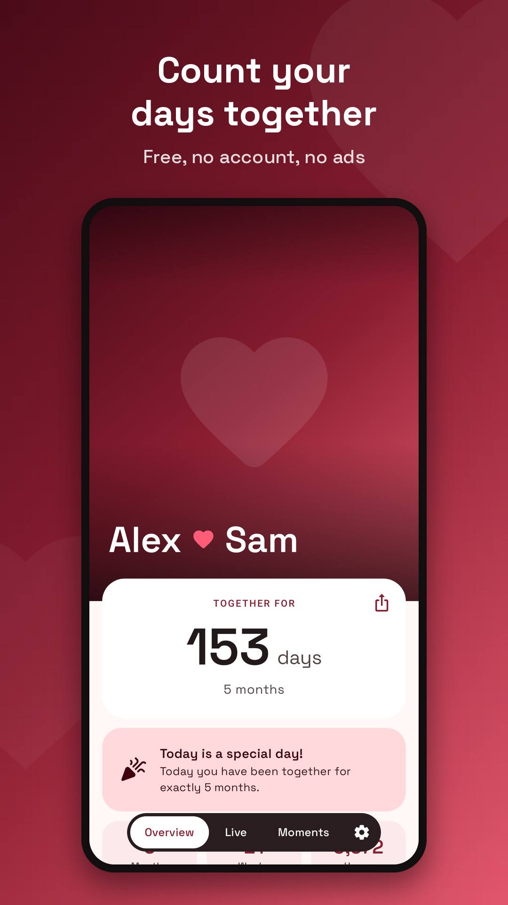
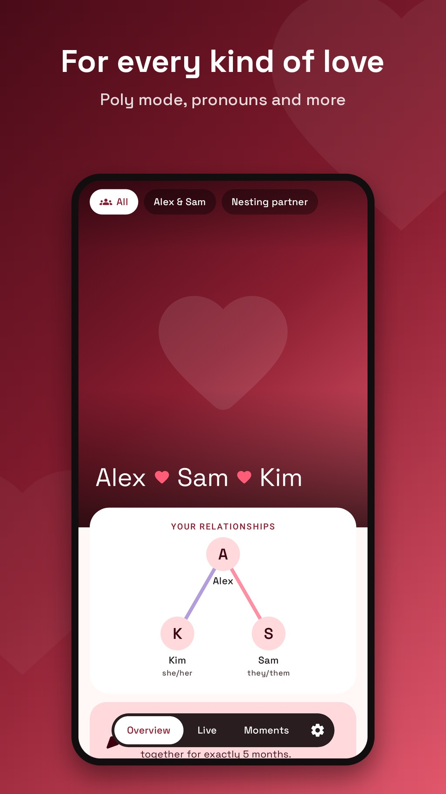
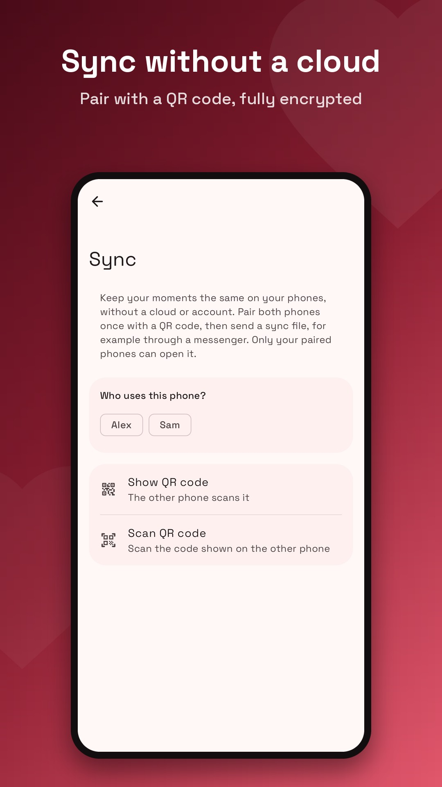

# Since Us

A privacy-friendly Android app for couples: counts how long you have been together and reminds you of every special day. Available in English and German.

  
  
  

## Features

- Days, weeks, months and hours together, plus a live counter down to the second
- Your own photo with adjustable framing, or one of several backgrounds, plus an optional slideshow with more photos
- Notifications on monthly and yearly anniversaries, every 100 days, fun numbers like 222 and every 50 weeks, at a time you choose
- Upcoming special days with a countdown
- Moments: a timeline of important moments with note, photo and yearly reminder (can be hidden)
- Two home screen widgets: a love card with your names and days together, and a compact counter in Material You colors
- Guided setup, optional start time, one-tap "delete all data"
- Backup as a file (all data and photos) to move to a new phone, without internet
- Sync between phones without a server: pair once with a QR code, then send each other an encrypted file (AES-256-GCM) that opens right in the app and only on your paired phones
- Light and dark mode, English and German, language can be changed right in the app
- No account, no ads, no tracking, all data stays on the device
- Poly mode: more than two people and several relationships, each with its own date, special days and reminders, plus a discreet mode with initials only
- For every kind of love, no matter who you are, whom you love or how many of you there are, with a little rainbow decoration in Pride Month (June)

## Third-party libraries

Since Us uses Android Jetpack (AndroidX, Jetpack Compose, Material 3, Glance, DataStore), Kotlin and kotlinx.coroutines, Coil, Okio, Guava ListenableFuture, Accompanist, JSpecify, Material Symbols, ZXing and ZXing Android Embedded (QR codes). All of them are licensed under the [Apache License 2.0](https://www.apache.org/licenses/LICENSE-2.0). The app lists them under *Settings → Open source licenses*.

## Download

| Where | Updates |
| --- | --- |
| [GitHub Releases](https://github.com/DerDieDasLian/sinceus/releases) | The app checks GitHub once a day, notifies you and installs the update with one tap (can be turned off). Also works with [Obtainium](https://github.com/ImranR98/Obtainium). |
| F-Droid | [Through F-Droid](https://f-droid.org/packages/app.sinceus/) |
| Google Play | Through the Play Store (closed test, [testers wanted](#help-test-on-google-play)) |

The three versions are signed differently, so switching between them requires uninstalling first.

Tip: if notifications arrive late, set *Settings → Apps → Since Us → Battery* to "Unrestricted".

## Help test on Google Play

Before Since Us can go live on Google Play, Google wants the app tested for 14 days by at least 12 people. Want to help? You need an Android phone and a Google account.

1. Write to [contact@sinceus.de](mailto:contact@sinceus.de?subject=Since%20Us%20Google%20Play%20test) with the Google address (Gmail) you use on your phone.
2. You get a link to join the test and install Since Us from Google Play.
3. Keep the app installed for 14 days and open it now and then. Feedback is welcome, but not required.

Your address is only used to add you to the test.

## Build variants

| Variant | Gradle task | Internet | Updates |
| --- | --- | --- | --- |
| `github` | `./gradlew assembleGithubRelease` | only for the update check | GitHub Releases |
| `fdroid` | `./gradlew assembleFdroidRelease` | none | F-Droid |
| `play` | `./gradlew bundlePlayRelease` | none | Google Play |

Tests, screenshots and store graphics: `./gradlew testGithubDebugUnitTest` (output in `app/build/screenshots` and `app/build/store`).

## Releasing

- **Signing:** create `keystore.properties` (not committed) with `storeFile`, `storePassword`, `keyAlias`, `keyPassword`. Without it, release builds stay unsigned (this is what F-Droid expects). In GitHub Actions the secrets `UPLOAD_KEYSTORE_BASE64`, `UPLOAD_KEYSTORE_PASSWORD`, `UPLOAD_KEY_ALIAS` and `UPLOAD_KEY_PASSWORD` are used.
- **Releases are made on purpose:** changes collect on the default branch until a release is started by hand (Actions > Release > Run workflow, type `auto`, `patch`, `minor` or `major`; `auto` honors `[minor]`/`[major]` in commit messages). The workflow bumps the version, checks that `fastlane/metadata/android/{de-DE,en-US}/changelogs/<versionCode>.txt` exist (at most 500 characters, shown in the app, on F-Droid and on GitHub), runs the tests, builds all variants, then commits the version, tags `v<versionName>` and publishes the signed APK. F-Droid builds every new tag. Every app change adds a line to the notes for the next versionCode; the Build workflow warns while they are missing. Pull before working, since the release workflow pushes version commits.
- **F-Droid** builds the `fdroid` variant from source; store texts and images are in `fastlane/`, a metadata template is in `fdroid/`.
- **Website:** `docs/` (landing page and privacy policy) is published via GitHub Pages and can be copied to any static web server.

## Tech

Kotlin, Jetpack Compose (Material 3), Glance widgets, DataStore, Coil. Minimum Android 8.0.

## Website

https://sinceus.de/ (privacy policy: [English](docs/privacy-en.html), [Deutsch](docs/privacy-de.html))

## How this app was made

This app was developed with AI assistance: the code was written with the help of an AI coding assistant and reviewed, tested and directed by the maintainer.

## License

[GNU General Public License v3.0 or later](LICENSE)
